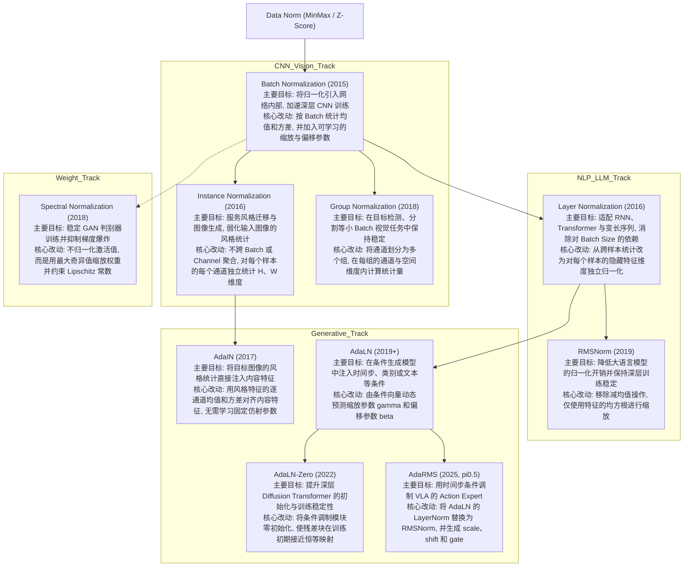

# Normalization in Deep Learning

深度学习中的归一化 (Normalization) 技术是现代神经网络模型能够成功训练的基石之一. 它的核心目的在于解决训练过程中的 Internal Covariate Shift (ICS) 问题, 即使得网络每一层的输入分布保持稳定. 从优化的角度看, 归一化极大地平滑了损失函数的曲面 (Loss Landscape), 减小了梯度的 Lipschitz 常数, 从而允许使用更大的学习率并加速收敛.

## Data Level Normalization

在将数据输入神经网络之前, 对输入数据进行预处理是必不可少的步骤. 这一层面的归一化不涉及网络内部的层结构, 而是直接作用于原始数据集. 在 2015 年内部归一化出现之前, 归一化主要就是指这类输入预处理.

### Min-Max Normalization

这种方法通过线性变换将数据映射到固定区间, 通常是 $[0, 1]$. 它保留了数据的原始分布结构, 但将量纲统一.

$$
x' = \frac{x - x_{min}}{x_{max} - x_{min}}
$$

| Advantages | Disadvantages |
| :--- | :--- |
| 1. 精确地将数据限制在特定的区间内 (如 0 到 1), 这对于需要输出在有界区间的激活函数 (如 Sigmoid) 非常重要.<br>2. 保留了原始数据的相对分布关系, 不改变数据的偏度. | 1. 对异常值 (Outliers) 极度敏感. 单个极端大值会将所有正常数据压缩到极小的区间, 导致特征失效.<br>2. 使得数据的均值和方差变得不确定, 不利于后续网络权重的初始化 (通常假设零均值输入). |

```python
import torch

def min_max_norm(x):
    # Epsilon 防止除以零
    return (x - x.min()) / (x.max() - x.min() + 1e-8)
```

### Z-Score Standardization

Z-Score 标准化将数据转换为均值为 0, 标准差为 1 的分布. 这是深度学习输入层最常用的预处理方式.

$$
x' = \frac{x - \mu}{\sigma}
$$

| Advantages | Disadvantages |
| :--- | :--- |
| 1. 对异常值具有较强的鲁棒性, 不会因为个别极值导致整体分布崩塌.<br>2. 产生零均值单位方差的分布, 完美契合神经网络权重的初始化假设 (如 Xavier Initialization), 有助于梯度传播. | 1. 数据的数值范围没有固定边界, 可能会出现非常大的绝对值.<br>2. 破坏了数据的原始稀疏性 (如果原始数据有很多 0, 减去均值后就不再是 0 了). |

```python
def z_score_norm(x):
    return (x - x.mean()) / (x.std() + 1e-8)
```

## Core Internal Normalizations

这是深度学习中最为重要的一类归一化, 它们作为网络层嵌入在模型结构中. 这些方法的区别主要在于计算均值和方差时所聚合的维度不同.

下面只用 PyTorch 张量运算展示最核心的归一化过程, 省略 Running Statistics、可选参数和底层优化等工程细节. 每段代码末尾保留对应的官方 `torch.nn` 层作为实际使用时的对照.

```python
import torch
import torch.nn as nn
```

### Batch Normalization

Ioffe 和 Szegedy 在 2015 年提出 Batch Normalization (BN), 首次将归一化系统性地引入网络内部. BN 在 Batch 维度 $(N)$ 以及空间维度 $(H, W)$ 上聚合, 对每个通道 $(C)$ 独立计算统计量, 并通过可学习参数 $\gamma$ 和 $\beta$ 恢复表达能力. 它是 CNN 时代的标配.

$$
\hat{x} = \frac{x - \mu_B}{\sqrt{\sigma_B^2 + \epsilon}} \cdot \gamma + \beta
$$

| Advantages | Disadvantages |
| :--- | :--- |
| 1. 极大地加速收敛速度, 允许使用更大的学习率.<br>2. 引入了与 Batch 相关的随机噪声, 起到了轻微的正则化效果, 降低了过拟合风险.<br>3. 对权重初始化的敏感度降低.<br>4. 部署方案成熟, 推理时通常可融合进相邻层. | 1. 高度依赖 Batch Size. 当 Batch Size 较小 (如 < 8) 时, 统计量估算不准, 导致模型性能崩溃.<br>2. 在 RNN 和 Transformer 等处理变长序列的模型中难以应用.<br>3. 训练和推理阶段计算逻辑不一致 (训练用 Batch 统计量, 推理用 Running 统计量). |

下面只展示 BN 在训练阶段使用当前 Batch 统计量的核心计算. 推理阶段所需的 Running Statistics 由 `nn.BatchNorm2d` 负责维护.

```python
class SimpleBatchNorm2d(nn.Module):
    def __init__(self, channels, eps=1e-5):
        super().__init__()
        self.eps = eps
        self.gamma = nn.Parameter(torch.ones(channels))
        self.beta = nn.Parameter(torch.zeros(channels))

    def forward(self, x):
        mean = x.mean(dim=(0, 2, 3), keepdim=True)
        var = x.var(dim=(0, 2, 3), correction=0, keepdim=True)
        x_hat = (x - mean) * torch.rsqrt(var + self.eps)
        return (
            x_hat * self.gamma.view(1, -1, 1, 1)
            + self.beta.view(1, -1, 1, 1)
        )


# PyTorch 内置实现
bn = nn.BatchNorm2d(64)
```

### Layer Normalization

Ba 等人在 2016 年提出 Layer Normalization (LN), 以解决 BN 对 Batch Size 的依赖以及难以处理变长序列的问题. LN 放弃了 Batch 维度, 转而在每个样本的特征维度上进行归一化; 对于 NLP 任务, 它通常在 Embedding 维度上聚合.

$$
\mu_L = \frac{1}{D} \sum_{i=1}^{D} x_i
$$

| Advantages | Disadvantages |
| :--- | :--- |
| 1. 计算完全独立于 Batch Size, 单条数据即可归一化.<br>2. 完美适用于 RNN 和 Transformer 等变长序列模型.<br>3. 训练和推理阶段的行为完全一致, 实现简单. | 1. 在卷积神经网络 (CNN) 中表现通常不如 BN, 因为它破坏了通道间的特征独立性.<br>2. 缺乏 BN 那种引入噪声带来的正则化效应, 可能更容易过拟合. |

下面以 Transformer 中最常见的“归一化最后一个特征维度”为例.

```python
class SimpleLayerNorm(nn.Module):
    def __init__(self, dim, eps=1e-5):
        super().__init__()
        self.eps = eps
        self.gamma = nn.Parameter(torch.ones(dim))
        self.beta = nn.Parameter(torch.zeros(dim))

    def forward(self, x):
        mean = x.mean(dim=-1, keepdim=True)
        var = x.var(dim=-1, correction=0, keepdim=True)
        x_hat = (x - mean) * torch.rsqrt(var + self.eps)
        return x_hat * self.gamma + self.beta


# 输入形状: (N, Sequence_Length, Embedding_Dim)
ln = nn.LayerNorm(normalized_shape=512)
```

### Instance Normalization

Ulyanov 等人在 2016 年面向风格迁移提出 Instance Normalization (IN). 它在每个样本的每个通道 $(H, W)$ 上独立计算统计量, 既不跨 Batch, 也不跨 Channel, 因而能够弱化原图的对比度和亮度等风格统计.

| Advantages | Disadvantages |
| :--- | :--- |
| 1. 能够归一化掉图像的对比度和亮度等风格信息, 使得模型专注于内容结构.<br>2. 在风格迁移 (Style Transfer) 和图像生成任务中效果显著. | 1. 丢弃了图像的全局统计信息, 对于图像分类等判别式任务会造成信息损失, 导致精度下降.<br>2. 仅适用于特定的视觉生成领域, 通用性较差. |

InstanceNorm 的基本形式不需要跨样本统计, 也不需要维护 Running Statistics.

```python
class SimpleInstanceNorm2d(nn.Module):
    def __init__(self, eps=1e-5):
        super().__init__()
        self.eps = eps

    def forward(self, x):
        mean = x.mean(dim=(2, 3), keepdim=True)
        var = x.var(dim=(2, 3), correction=0, keepdim=True)
        return (x - mean) * torch.rsqrt(var + self.eps)


# PyTorch 默认 affine=False, track_running_stats=False
in_norm = nn.InstanceNorm2d(64)
```

### Group Normalization

He 等人在 2018 年针对小 Batch 视觉任务提出 Group Normalization (GN). 它是 LN 和 IN 之间的折中方案, 将通道 $C$ 分成 $G$ 个组并在组内计算统计量; 当 $G=1$ 时接近 LN, 当 $G=C$ 时等价于 IN.

| Advantages | Disadvantages |
| :--- | :--- |
| 1. 解决了小 Batch Size 问题, 即使 Batch Size 为 1 也能稳定训练.<br>2. 在目标检测和分割等高分辨率图像任务中表现优异.<br>3. 计算不依赖 Batch, 推理和训练一致. | 1. 引入了额外的超参数 (Group Number), 需要针对任务进行调整.<br>2. 在大 Batch Size 的分类任务上, 最终精度通常仍略低于 BN.<br>3. 推理时通常无法像 BN 那样直接融合进卷积层. |

GroupNorm 的关键是先把通道拆成 $G$ 组, 再对每组内的通道和所有空间维度共同计算统计量.

```python
class SimpleGroupNorm(nn.Module):
    def __init__(self, num_groups, num_channels, eps=1e-5):
        super().__init__()
        self.num_groups = num_groups
        self.num_channels = num_channels
        self.eps = eps
        self.gamma = nn.Parameter(torch.ones(num_channels))
        self.beta = nn.Parameter(torch.zeros(num_channels))

    def forward(self, x):
        grouped = x.reshape(x.shape[0], self.num_groups, -1)
        mean = grouped.mean(dim=-1, keepdim=True)
        var = grouped.var(dim=-1, correction=0, keepdim=True)
        x_hat = ((grouped - mean) * torch.rsqrt(var + self.eps)).reshape_as(x)

        shape = (1, self.num_channels) + (1,) * (x.ndim - 2)
        return x_hat * self.gamma.view(shape) + self.beta.view(shape)


# 将 64 个通道划分为 8 组
gn = nn.GroupNorm(num_groups=8, num_channels=64)
```

## Normalization for Transformer and LLMs

随着 Transformer 架构的统治, 归一化技术针对深度和数值稳定性进行了专门的优化.

### RMSNorm

Zhang 等人在 2019 年提出 [[RMS|Root Mean Square]] Layer Normalization (RMSNorm), 对 LN 进行简化: 去除 Mean Centering (减去均值) 操作, 仅保留均方根缩放.

$$
\bar{x}_i = \frac{x_i}{\text{RMS}(x)} g_i
$$

| Advantages | Disadvantages |
| :--- | :--- |
| 1. 减少了计算量 (不需要计算均值), 提升了训练和推理速度.<br>2. 在深层网络 (Deep Networks) 中数值稳定性更好, 梯度流更平滑.<br>3. 现代大模型 (Llama, PaLM) 的首选方案. | 1. 理论上丧失了平移不变性 (Shift Invariance), 虽然在 LLM 实践中证明这并不重要.<br>2. 需要特定的算子优化才能发挥最大的速度优势. |

现代 PyTorch 已提供 `nn.RMSNorm`. 与 LayerNorm 相比, 实现中不计算均值, 也没有可学习的偏移参数.

```python
class SimpleRMSNorm(nn.Module):
    def __init__(self, dim, eps=1e-8):
        super().__init__()
        self.eps = eps
        self.weight = nn.Parameter(torch.ones(dim))

    def forward(self, x):
        rms = torch.sqrt(x.pow(2).mean(dim=-1, keepdim=True) + self.eps)
        return x / rms * self.weight


# PyTorch 内置实现
rms_norm = nn.RMSNorm(512)
```

## Conditional and Adaptive Normalizations

在生成式模型中, 归一化成为了注入外部条件 (如文本描述, 时间步) 的接口.

### AdaLN-Zero

AdaLN 首先将 LN 中固定的 Scale ($\gamma$) 和 Shift ($\beta$) 改为由条件向量动态生成; AdaLN-Zero 则在此基础上加入零初始化. Peebles 等人在 2022 年的 DiT ([[2212.09748|DiT]]) 中采用这一设计, 使残差块在训练初期接近恒等映射.

$$
\text{AdaLN}(x, c) = (1 + \gamma(c)) \cdot \text{Norm}(x) + \beta(c)
$$

| Advantages                                                                                                        | Disadvantages                                                    |
| :---------------------------------------------------------------------------------------------------------------- | :--------------------------------------------------------------- |
| 1. 零初始化使得整个残差块在训练初期表现为恒等映射 (Identity), 极大地稳定了深层模型的训练.<br>2. 能够根据时间步和文本提示灵活调节每一层的特征分布.<br>3. 是目前 SOTA 扩散模型生成的关键技术. | 1. 引入了额外的 MLP 模块来预测参数, 略微增加了参数量.<br>2. 需要精心设计的初始化策略, 否则容易导致训练发散.<br>3. 主要面向条件生成任务, 不适用于普通判别任务. |

下面只保留 AdaLN-Zero 的三个核心部分: LayerNorm、条件生成的 Shift/Scale/Gate, 以及零初始化的残差门控.

```python
class SimpleAdaLNZero(nn.Module):
    def __init__(self, dim, cond_dim):
        super().__init__()
        self.norm = nn.LayerNorm(dim, elementwise_affine=False)
        self.block = nn.Linear(dim, dim)
        self.modulation = nn.Linear(cond_dim, 3 * dim)
        nn.init.zeros_(self.modulation.weight)
        nn.init.zeros_(self.modulation.bias)

    def forward(self, x, c):
        shift, scale, gate = self.modulation(c).chunk(3, dim=-1)
        h = self.norm(x) * (1 + scale[:, None]) + shift[:, None]
        return x + gate[:, None] * self.block(h)
```

### AdaRMS

2025 年, OpenPI 在 [[2504.16054|pi0.5]] 中采用 AdaRMS. 它可以看作 AdaLN 的 RMSNorm 版本: 将 LayerNorm 替换为不减均值的 RMSNorm, 再由条件向量生成 Scale、Shift 和 Gate. 在 $\pi_{0.5}$ 中, 条件向量来自 Flow Matching 的时间步嵌入, 用于调制 Action Expert.

$$
\text{AdaRMS}(x,c)
= \text{RMSNorm}(x) \cdot (1 + \gamma(c)) + \beta(c)
$$

残差分支进一步使用 $g(c)$ 作为门控:

$$
y = x + g(c) \cdot F(\text{AdaRMS}(x,c))
$$

| Advantages                                                                                      | Disadvantages                                                           |
| :---------------------------------------------------------------------------------------------- | :---------------------------------------------------------------------- |
| 1. 保留 RMSNorm 不需要计算均值的效率优势.<br>2. 将时间步条件直接注入每个 Transformer Block.<br>3. 调制层零初始化后, 模块初始状态接近恒等映射. | 1. 与 RMSNorm 一样不具备平移不变性.<br>2. 需要额外的条件映射层, 主要适用于条件生成和 Flow Matching 模型. |

```python
class SimpleAdaRMS(nn.Module):
    def __init__(self, dim, cond_dim, eps=1e-8):
        super().__init__()
        self.eps = eps
        self.block = nn.Linear(dim, dim)
        self.modulation = nn.Linear(cond_dim, 3 * dim)
        nn.init.zeros_(self.modulation.weight)
        nn.init.zeros_(self.modulation.bias)

    def forward(self, x, c):
        rms = torch.sqrt(x.pow(2).mean(dim=-1, keepdim=True) + self.eps)
        normalized = x / rms
        scale, shift, gate = self.modulation(c).chunk(3, dim=-1)
        h = normalized * (1 + scale[:, None]) + shift[:, None]
        return x + gate[:, None] * self.block(h)
```

## Weight Based Normalization

这一类方法不归一化激活值, 而是直接约束权重矩阵.

### Spectral Normalization

Miyato 等人在 2018 年为稳定 GAN 判别器训练提出 Spectral Normalization (SN). 与归一化激活值的方法不同, SN 直接将权重矩阵除以其最大的奇异值 (谱范数), 从而约束网络的 Lipschitz 常数.

$$
W_{SN} = \frac{W}{\sigma(W)}
$$

| Advantages | Disadvantages |
| :--- | :--- |
| 1. 严格限制了网络的 Lipschitz 常数, 防止梯度爆炸.<br>2. 极大地稳定了 GAN (生成对抗网络) 的判别器训练.<br>3. 不需要计算 Batch 统计量. | 1. 计算最大奇异值需要使用幂迭代法 (Power Iteration), 增加了计算开销.<br>2. 可能会过度限制模型的表达能力, 导致生成结果过于平滑. |

最基础的实现可以直接计算权重矩阵的最大奇异值并进行缩放. PyTorch 内置版本为了效率会使用幂迭代近似该值.

```python
class SimpleSpectralLinear(nn.Linear):
    def forward(self, x):
        weight_matrix = self.weight.reshape(self.out_features, -1)
        sigma = torch.linalg.matrix_norm(weight_matrix, ord=2)
        weight = self.weight / (sigma + 1e-12)
        return torch.nn.functional.linear(x, weight, self.bias)


# PyTorch 推荐使用 Parametrization API
sn_layer = nn.utils.parametrizations.spectral_norm(nn.Linear(32, 64))
```

# Evolution of Normalization

深度学习归一化技术的发展并非简单的线性替代, 而是随着模型架构 (CNN, RNN, Transformer) 和任务需求 (分类, 生成, 风格迁移) 的变化而不断分化. 以下是按时间顺序梳理的技术演进细节.

## Evolution Timeline


