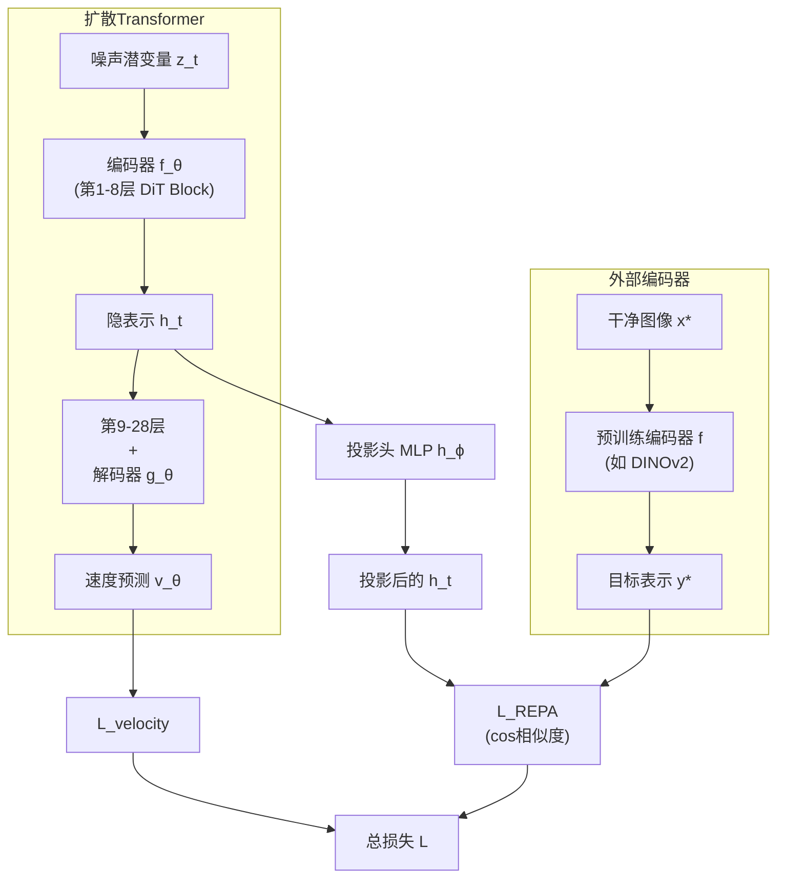

> [!note]- paper
![[Paper/PDF/2410.06940v4.pdf]]

## Abstract

用于加速 [[2212.09748|DiT]] 的训练并提升生成质量. 做法是让 [[2212.09748|DiT]] 在去噪过程中产生的hidden layer repr与一个外部的自监督视觉编码器(如, [[DINOv2]])在干净的图像上产生的repr对齐
## Motivation

1. [[2212.09748|DiT]] 学习到的表示于自监督编码器之间存在巨大的语义差距. 即使是train 7000k-step的[[SiT]]-XL/2, latent的表示质量也比[[DINOv2]]差
2. [[2212.09748|DiT]] 的表示与其他的自监督编码器之间的对齐很弱
3. 这个对齐随着更大模型和更长时间的训练而增强

## Methods

假设一个 [[2212.09748|DiT]] 网络为$v_\theta=g_\theta\circ f_\theta(z_t)$, 由编码器$f_\theta$和解码器$g_\theta$组成. 令$h_t=f_\theta(z_t)$表示第$k$层Transformer Block输出的hidden state.

REPA将这个hidden state经过一个可训练的 [[Deep Learning#Multi-Layer Network|MLP]] $h_\phi$ 映射到feature空间, 通过 patch-wise 相似度来实现对齐:
$$\mathcal L_{REPA}=-\mathbb E_{x^*,\epsilon,t}\left[\frac{1}{N}\sum_{n=1}^N\text{sim}\left(y^*_{[n]},h_\phi(h_t^{[n]})\right)\right]$$
- $\text{sim}$ 是相似性函数. 经过比较, 使用"负余弦相似度(negative cosine similarity)" 效果较好且更简单
- $y^*$ 是原始的干净的图像经过冻结的编码器 (如, [[DINOv2]],[[SigLip]]) 得到的feature
- 对patch做similarity, 因此拆分成$N$个patch, 逐一去做相似性

最终的loss为:
$$\mathcal L=\mathcal L_{velocity}+\lambda\mathcal L_{REPA}$$

经测试, $\lambda=0.5$时效果饱和, 取值相对鲁棒

