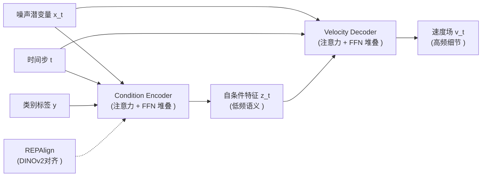

> [!note]- paper
![[Paper/PDF/2504.05741v2.pdf]]

## Abstract

提出DDT, 一种解耦的编码器/解码器 [[2212.09748|DiT]] 架构. 传统的[[Diffusion]] [[1706.03762|Transformer]]  (如, [[2212.09748|DiT]], [[SiT]] )  在同一个模块下同时承担低频的语义信息和高频的pixel细节解码任务, 导致优化内在的矛盾.

因此, DDT把这个过程拆分成两个独立的组件:
- Condition Encoder: 提取低频语义
- Velocity Decoder: 接受 Condition Encoder 提取到的信息, 并回归高频速度场

## Motivation

1. 频谱自回归特性: [[2504.05741v2.pdf#page=3&selection=231, 0, 232, 1|Lemma 1]] 指出, 在某个denoise step $t$, 噪声潜变量保留的最大频率满足 $f_{\max} (t ) >\min\left (\left (\frac{t}{1-t}\right ) ^2, K_{freq}\right ) $, 意味着$t$越小 (越靠近噪声 ) , 能编码的语义频率越低, 解码剩余频率的负担越重
2. 实验证明, 通过改变 time-shift 值, 给早期高噪声部分分配更多计算资源, 能够显著提升性能. 证明 [[2212.09748|DiT]] 不是高频解码不行, 而是低频的语义编码能力不足
3. 传统的 [[2212.09748|DiT]] 是decoder-only架构, 编码低频语义的时候必然衰减高频信息

## Methods

### 整体架构

![[2504.05741v2.pdf#page=1&rect=58, 408, 360, 595]]

DDT 将传统 decoder-only 的扩散Transformer拆解为两个独立模块：

### Condition Encoder

编码器在架构上镜像 [[2212.09748|DiT]]/[[SiT]] 的设计

输入处理：
- 噪声潜变量 $x_t$ 被 patchify 成连续 token
- 时间步 $t$ 和类别标签 $y$ 被投影为嵌入向量, 通过 [[PyTorch Normalization#AdaLN-Zero|AdaLN-Zero]] 逐块注入编码特征

Loss 来自于两点:
1. [[2410.06940|REPA]] 损失：为了保持 $z_t$ 在相邻时间步间的局部一致性, 采用 [[2410.06940|REPA]] 中的表示对齐技术。将编码器第 $i$ 层的中间特征 $h_i$ 通过可学习的投影 [[Deep Learning#Multi-Layer Network|MLP]] $h_\phi$ 投影后, 与预训练的 [[DINOv2]] 表示 $r^*$ 做余弦对齐：
   
   $$\mathcal{L}_{\text{enc}} = 1 - \cos (r^*, h_\phi (h_i )  ) $$

   这个损失有两个作用: 一方面加速训练收敛 (如 REPA 所展示的 ), 另一方面强制 $z_t$ 在相邻时间步间保持连续, 为后续推理共享打下基础。
2. Velocity Decoder 的回传梯度, 通过 velocity 回归损失间接约束编码器。

### Velocity Decoder

使用标准的 [[2212.09748|DiT]]/[[SiT]]架构, 采用标准的 [[2210.02747|Flow Matching]] 损失：
$$\mathcal{L}_{\text{dec}} = \mathbb{E}\left[\int_0^1 || (x_{\text{data}} - \epsilon )  - v_t||^2 dt\right]$$

### Encoder Sharing

这是 DDT 的一个"副产品"式的贡献：由于 [[2410.06940|REPA]] 正则化, $z_t$ 在相邻时间步间展现出强局部一致性 ([[2504.05741v2.pdf#page=7&rect=317, 267, 561, 504|Fig.5]] 显示即使 $z_{t=0}$ 与 $z_{t=1}$ 的余弦相似度也在 0.8 以上 ) , 因此可以在推理时跳过部分编码器计算, 直接复用上一步的 $z_t$。

**形式化定义**：设总推理步数为 $N$, 编码器计算预算为 $K$ (即只计算 $K$ 次编码器 ) , 共享率为 $1 - \frac{K}{N}$。令 $\Phi$ ($|\Phi| = K$ ) 为需要**重新计算**自条件的时间步集合：

$$z_t = \begin{cases}
z_{t-\Delta t}, & \text{if } t \notin \Phi \\
\text{Encoder} (x_t, t, y ) , & \text{if } t \in \Phi
\end{cases}$$

两种策略确定 $\Phi$：

#### Uniform

简单地每 $\frac{N}{K}$ 步计算一次编码器。这是 DeepCache 等工作的做法, 但它是手工设计的规则, 并非最优。

#### Statistic Dynamic Programming

在一批经典样本上计算每一个 $z_t$ 之间的平均余弦相似度, 得到一个固定的相似度矩阵 $S$

### Encoder-Decoder Ratio

论文通过系统性的消融实验 ([[2504.05741v2.pdf#page=8&rect=52,414,559,729|Fig.7, Fig.8]]) 发现了一个反直觉的规律：

| 模型规模 | 最优比例 | 编码器层数 | 解码器层数 |
|---------|---------|-----------|-----------|
| B/2 | 2:1 | 8 | 4 |
| L/2 | **5:1** | **20** | **4** |
| XL/2 | 3.67:1 | 22 | 6 |

随着模型规模增大, 最优的编码器-解码器比例**越来越偏向编码器**。Large 模型甚至达到了惊人的 20:4 (5:1 ) 比例, 说明**低频语义编码是高分辨率高容量模型的主要瓶颈**, 解码高频细节反而相对"容易"——4 层解码器已经足够。
